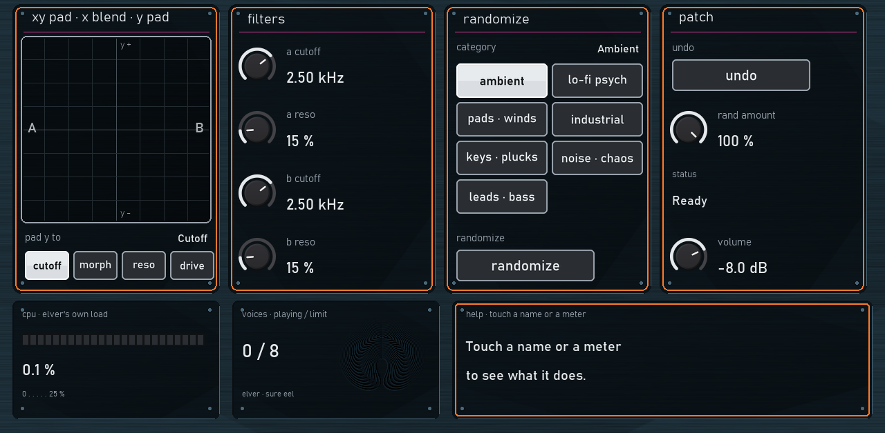
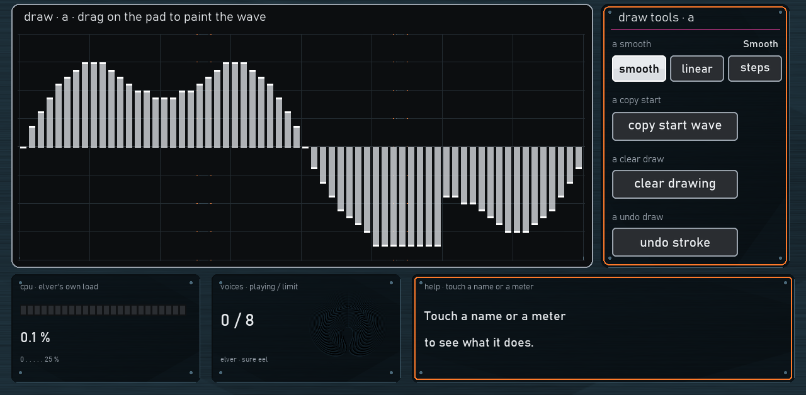
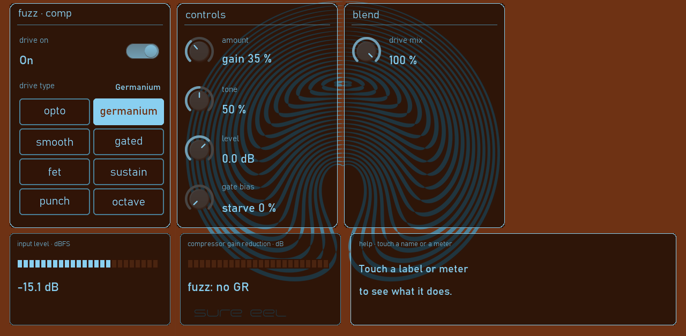

# plug-in-collection

A collection of vibe-coded instruments and effects that I wanted and thought someone else might too,
for **Akai MPC** and **Akai Force** standalone hardware. By Sure Eel (shown on the device as
manufacturer **sureeel**).

| Plugin | What it is |
|---|---|
| [Elver](#elver) | Two-sided synthesizer with a wave shaper you draw with your finger, an XY pad and a mood randomizer |
| [Hydra Eel](#hydra-eel) | Spaghetti western guitar rig: compressors and fuzzes, tremolo / vibrato or rotary / phaser, delay, plate, spring or shimmer reverb |
| [LUFS Master](#lufs-master) | Loudness meter, leveler and true-peak limiter: measure a pass, auto-set the gain, land on target |
| [Sleepy Android](#sleepy-android) | Guitar envelope filter (after the Mutronics Mutator) plus a random capture-and-loop stutter |

More plugins are on the way.

---

## Elver

A clean, simple, low-memory synthesizer. It has two sides, **A** and **B**. Each has three oscillators
(with unison), its own filter (24 dB LP, 12 dB LP, band-pass, high-pass, notch) and its own amp and
filter envelopes. An **XY pad** blends A into B and sweeps cutoff, morph, resonance or drive. Two LFOs,
slow drift, drive, bit-crush grit and ring modulation round it out.

**Shape and drawing:** each side has a Shaper.
- Start from one of 60 original library waves (analog, vowels, FM bells, organs, digital, harmonic,
  noise), or **draw your own wave with your finger** on the DRAW page: your first stroke switches oscillator 1 to Shape, so you hear the drawing at once.
- Then sculpt it with Bright, Odd/Even, Formant, Fold, Bend, Sync and a seeded Mutate.
- The wave is band-limited, so high notes don't alias, and changes crossfade without clicks.

**Randomize** builds a new sound in one of seven moods, from calmest to noisiest: Ambient, Pads & Winds,
Keys & Plucks, Leads & Basses, Lo-Fi Psych, Industrial, Noise & Chaos. It has an amount control, Undo
and section locks. Presets are organised by the same seven categories (4 factory and 8 user slots each).
You name a preset on an on-screen letter grid.

There are four panel skins: Neon Rain, Capsule Red, Monolith and Derelict. Elver shows its own CPU load
and the voices playing.





*The MAIN page and a DRAW page with a hand-drawn wave, rendered from the plugin's own skin files with
real values (fonts are approximate). 13 pages in all: MAIN, OSC, SHAPE and DRAW for each side, TUNE,
FILTER, ENV, MOD, PRESET and SAVE.*

### Install

Download **`elver-...-force-armv7.zip`** (32-bit, Akai Force) or **`elver-...-mpc-aarch64.zip`** (64-bit,
MPC Key 37 Gen 2) from the [Elver release](https://github.com/SureEel/plug-in-collection/releases/tag/elver-v1.1.1).
Copy the folder **`sureeel - VST - Elver`** into **`VST2 Plugins`**, switch on the two Enhancements
settings (MPC OS / Force OS 3.10.1+) and restart. Elver is an instrument: load it on a plugin track.

### Use

- **MAIN:** drag the XY pad (X = A↔B blend, Y = what **Pad Y To** selects). Pick a **Category** and tap
  **Randomize**; **Undo** goes back.
- **OSC A / OSC B:** wave, level, octave and semitone for each oscillator, plus unison.
- **SHAPE A / SHAPE B:** set an oscillator's wave to **shape** to hear the Shaper. Start From picks the
  library wave; the scope shows the cycle.
- **DRAW A / DRAW B:** paint the wave on the pad. **Draw Mix** blends it with the start wave.
  **Copy Start**, **Clear** and **Undo** are the editing tools.
- **PRESET / SAVE:** tap the Preset box for a list of all presets; picking one loads it. To save, type a name, choose a category, then Confirm.
- Volume, Output and the skin are global: loading a preset never changes your levels.

Touch any control's name to see what it does. Details: [plugins/Elver/README.md](plugins/Elver/README.md).

---

## Hydra Eel

A spaghetti western guitar rig in the spirit of Morricone: twangy tremolo, spring reverb and gritty
fuzz, plus compressors for funk and jazz. The signal runs **Drive** > **Mod** > **Delay** > **Reverb** >
mono / stereo > output, with a -1 dBFS safety limiter. Each section has its own On switch, crossfades
without clicks, and costs nothing when off.



*The DRIVE page, rendered from the plugin's own skin files with real readouts (fonts are approximate).
Five pages: MAIN, DRIVE, MOD, DELAY and REVERB.*

### Install

Download **`hydra-eel-...-force-armv7.zip`** (32-bit, Akai Force) or **`hydra-eel-...-mpc-aarch64.zip`**
(64-bit, MPC Key 37 Gen 2) from the
[Hydra Eel release](https://github.com/SureEel/plug-in-collection/releases/tag/hydra-eel-v1.0.0).
Copy the folder **`sureeel - VST - Hydra Eel`** into **`VST2 Plugins`**, switch on the two
Enhancements settings (MPC OS / Force OS 3.10.1+) and restart. Insert it on a guitar track or input.

### Controls

| Page | Controls |
|---|---|
| MAIN | Input, Output (global: presets never change them), Bypass, mono / stereo; Randomize, Undo, Rand Amount; Save Preset with naming |
| DRIVE | Drive type, cleanest to dirtiest. **Compressors:** opto, smooth, fet, punch. **Fuzzes:** germanium, gated, sustain, octave. Then Amount, Tone, Level, **Gate Bias** (gate on the compressors, "starve" on the fuzzes) and Drive Mix |
| MOD | trem / vib or rotary / phaser, Blend, Wave, Rate (Hz or tempo sync), Depth, rotor slow / fast |
| DELAY | digital or analog (darker, a little wobble), ms or tempo-synced Time, Feedback, Mix |
| REVERB | plate, spring or shimmer; Decay, Tone, Mix |

Touch any name or meter for help. Factory presets include **Lonesome Trail**, **Showdown**,
**Ennio Twang**, **Ghost Town** and **Octave Outlaw**, plus **Funk Chicken** and **Jazz Box** on the
compressors. The compressor and fuzz positions are inspired by classic units' behaviour; they are
not circuit models. Details: [plugins/Hydra Eel/README.md](plugins/Hydra%20Eel/README.md).

---

## LUFS Master

A loudness meter, leveler and true-peak limiter (ITU-R BS.1770 / EBU R128) for mastering and live
broadcast. Measure a pass; when the transport stops, LUFS Master sets the gain for you, and the next
pass lands on your loudness target. True peaks never go above the ceiling.


*The MASTER page, rendered from the plugin's own skin files with real readouts captured while it
measured a test signal (fonts are approximate). A second page, METERS, shows output loudness over time
against the target, and every meter as a number.*

### Install

1. Download the zip for your hardware from the
   [LUFS Master release](https://github.com/SureEel/plug-in-collection/releases/tag/lufs-master-v1.1.0):
   - **`...-force-armv7.zip`**: 32-bit hardware, including the **Akai Force**.
   - **`...-mpc-aarch64.zip`**: 64-bit hardware, including the **MPC Key 37 Gen 2**.

   A build for the wrong type is silently ignored by the device. If you are not sure which type
   yours is, install both: they hold the same plugin and each device uses the build it can run.
2. Unzip it. Copy the folder **`sureeel - VST - LUFS Master`** into a folder named
   **`VST2 Plugins`** at the top of a drive your MPC / Force uses (internal drive, SD card or
   USB). Create `VST2 Plugins` if it does not exist.
3. On the device: **Preferences → Enhancements (Beta)**, switch on **Enable Enhancements** and
   **External Plugin Support**. Needs **MPC OS / Force OS 3.10.1 or later**.
4. Restart the device. Insert **LUFS Master** (manufacturer **sureeel**) as an insert effect,
   last on the track or master you want to deliver. To bypass it, switch the plugin off.

### Use

1. Pick a **Target** and a **Ceiling**:
   - **Target:** -14 LUFS (streaming), -16 (Apple Music / podcasts), -23 (EBU R128), -24 (ATSC A/85)
     or Custom.
   - **Ceiling:** a true peak, default -1.0 dBTP.
2. Choose **Measure** with **Live Speed Off**, and play the song once. The **Suggested Gain** shows what
   would put it on target.
3. Stop the transport. **Auto-set** writes the gain into **Input Gain**, switches to **Manual** and shows
   **APPLIED**. Play or record again: **Output Integrated** lands on the target. **Clear** or **Undo**
   take the auto-set back.
4. **Live:** choose Measure with Live Speed **Fast** (live broadcast) or **Slow** (mastering), and the
   gain follows the material automatically, smoothly, within ±**Max Change**.

| Control | What it does |
|---|---|
| Mode | **Manual** (your Input Gain) or **Measure** (listen, suggest, and with Fast / Slow adjust) |
| Live Speed | **Fast** (live broadcast) / **Off** (measure only) / **Slow** (mastering) |
| Input Gain | Gain in dB, used in Manual; auto-set writes it when a pass stops |
| Max Change | The most Fast / Slow may move the gain, ±1 to 24 dB |
| Target / Custom LUFS | The loudness to reach; Custom allows -30 to -6 LUFS |
| Ceiling | True-peak ceiling, -12 to 0 dBTP (8× oversampled look-ahead limiter, 160 samples latency) |
| Input level | Raw input peak in dBFS, before any gain, with a 2 s peak hold |
| Output integrated / LUFS over time | This pass at the output, and the last 3 s, both against the target |
| Gain change | The gain applied now; the limiter's reduction is shown below it |
| Clear / Undo | Input Gain to 0 dB / back to before the auto-set |
| Reset / Refresh | Start a new pass / clear the max readouts |

Touch any meter or label to see an explanation in the help window. Details, measured accuracy
and the test method are in [plugins/LUFS Master/README.md](plugins/LUFS%20Master/README.md).

---
## Sleepy Android

A guitar effect in two parts: **Android**, an envelope filter modelled on the Mutronics Mutator
(24 dB/octave low-, band- or high-pass, envelope or gate mode, LFO, auto sweep), and **Sleepy**, a
capture-and-loop stutter with fixed or random, tempo-synced lengths. They run in either order or
in parallel, and touch sensitivity, a patch randomizer, expression-pedal morphing, user presets
with naming, and a -1 dBFS safety limiter are built in.


*The FILTER page, rendered from the plugin's own skin files with real readouts captured mid-pluck
(fonts are approximate). Five more pages: MAIN, SWEEP, STUTTER, RANDOM and PATCH.*

### Install

Same as LUFS Master: download **`sleepy-android-...-force-armv7.zip`** (32-bit, Akai Force) or
**`sleepy-android-...-mpc-aarch64.zip`** (64-bit, MPC Key 37 Gen 2) from the
[Sleepy Android release](https://github.com/SureEel/plug-in-collection/releases/tag/sleepy-android-v1.0.1), copy the folder
**`sureeel - VST - Sleepy Android`** into **`VST2 Plugins`**, enable the two Enhancements switches
(MPC OS / Force OS 3.10.1+) and restart. Insert it on a guitar track or input.

### Controls

Touch any control's name or a meter to see an explanation in the help window.

| Page | Controls |
|---|---|
| MAIN | Input Gain, Output, Mix, Bypass; Routing (filter then stutter, stutter then filter, parallel); **Pedal** (map your expression pedal here); pedal assign: Assign, turn a knob, Set Heel, move it, Set Toe; Clear; Save Preset |
| FILTER | **Envelope follower**: Sensitivity, Attack (to 2 s), Release (to 5 s), env or gate mode, activity LED. **LFO**: Rate (0.1-100 Hz), Depth, Shape (tri, square, ramp up, ramp down), LFO To (filter, volume, both). **Filter**: Cutoff (resting point), Sweep (-6 to +6 octaves), Resonance (strong twang, cannot squeal), Type (LP, BP, HP). **Output**: VCA, Filter Mix, Stereo, Filter On |
| SWEEP | Auto Sweep, direction (up, down, up-down), range, slowest and fastest speed; touch: Env Touch and Sweep Touch, each with an amount |
| STUTTER | Stutter On, **Trigger** (loops while on: tap on and off on screen, hold on a Q-Link or footswitch) with a looping light, Hold (latch), Dry Mute; fixed or random, ms or tempo; Slice, Loop, Feedback (100 % freezes), Stutter Mix |
| RANDOM | Slice and Loop min / max, Rand Width, how often new lengths are picked (slowest, fastest); touch: Stut Touch with an amount |
| PATCH | Randomize (never touches bypass, input or output), Undo, amount, section locks; Save Preset, Confirm, Cancel, and the letter picker (Name Pos, Letter) |

**Saving a preset:** tap Save Preset; it suggests "Random 01" or "User 01". Pick a character with
Name Pos, change it with Letter, then tap Confirm (or Save again). It joins the preset list after
the factory presets and is kept across restarts.

**Factory presets:** the basics (Init, Quack Funk, Down Sweep, Gate Wah, and more), **RH** presets
inspired by Radiohead, **AB** presets inspired by Adrian Belew, and **XT** extreme presets. The
inspired-by presets are original settings in the spirit of those sounds, not copies. Full details
and test results are in [plugins/Sleepy Android/README.md](plugins/Sleepy%20Android/README.md).

---

## Build from source

The plugins are built with the MPC Plugin Builder SDK, included in this repository. You need
Python 3 (Windows, macOS or Linux); the first build downloads a compiler into `.sdk-tools/`.

```
python tools/build.py "plugins/LUFS Master"
python tools/build.py "plugins/Sleepy Android"
python tools/build.py "plugins/Elver"
python tools/build.py "plugins/Hydra Eel"
```

The finished plugin folders appear in `plugins/<name>/build/`. The touch panels are generated
by `plugins/<name>/skin_src/make_skin.py` (run it after a layout change, before `build.py`).
See [GETTING_STARTED.md](GETTING_STARTED.md) and [docs/SDK-README.md](docs/SDK-README.md) for the
SDK itself.

## Licence

- The plugins (everything in `plugins/`) are MIT-licensed, © 2026 Sure Eel: see [LICENSE](LICENSE).
- The MPC Plugin Builder SDK (everything else) is MIT-licensed, © 2026 inMusic Brands, Inc.: see
  [LICENSE-SDK](LICENSE-SDK). Additions in `framework/mpc_plugin.h`:
  - optional preset hooks (`programLoaded`, `programSetsParam`);
  - a project-restore fix that keeps the selected preset;
  - guards against NaN or infinite samples and parameter values;
  - a silence watchdog.

  They change nothing for plugins that don't use them. `tools/restore_test.cpp` and
  `tools/hostile_test.cpp` are added desktop test tools.
- The **Sure Eel logo** and the artwork made from it are **not** covered by the MIT licence: all
  rights reserved. That covers:
  - Sleepy Android's `skin_src/reference/`, `skin_src/assets/bg_logo.png` and
    `skin_src/assets/logo_96.png`;
  - Elver's `skin_src/reference/`;
  - Hydra Eel's `skin_src/reference/`, `skin_src/assets/bg_hydra.png` and `skin_src/assets/hydra_logo.png`;
  - the page backgrounds generated from them, including Elver's `skins/elver_panel.png` and Hydra Eel's `skins/panel_*.png`.
- Sleepy Android's, Elver's and Hydra Eel's button labels are rendered with the Bahnschrift font that ships with
  Windows.
