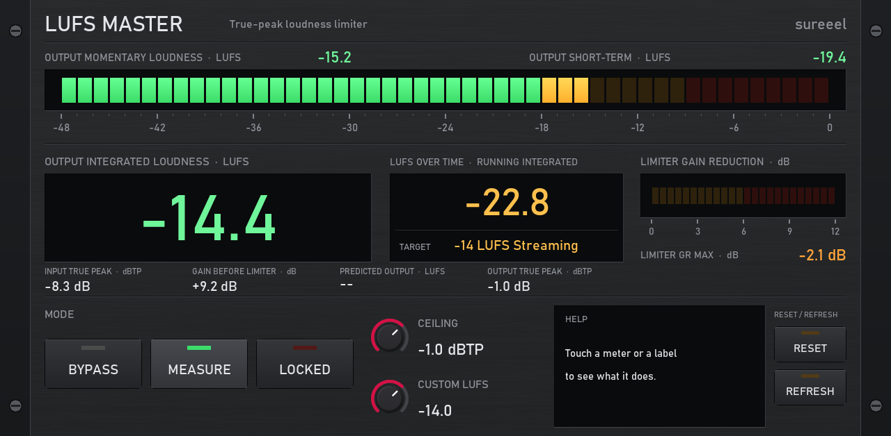
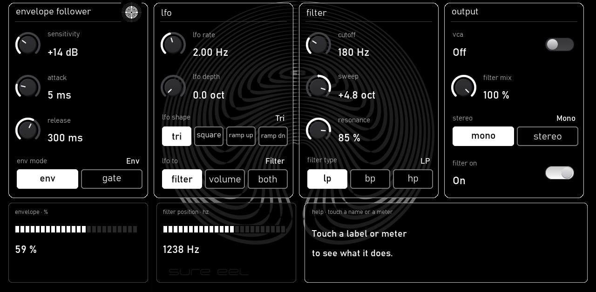

# plug-in-collection

A collection of vibe-coded effects that I wanted and thought someone else might too, for
**Akai MPC** and **Akai Force** standalone hardware. By Sure Eel (shown on the device as
manufacturer **sureeel**).

| Plugin | What it is |
|---|---|
| [LUFS Master](#lufs-master) | Loudness meter, leveler and transparent true-peak limiter |
| [Sleepy Android](#sleepy-android) | Guitar envelope filter (after the Mutronics Mutator) plus a random capture-and-loop stutter |

More plugins are on the way.

---

## LUFS Master

A loudness meter, live leveler and transparent true-peak limiter for mastering to streaming or
broadcast loudness targets (ITU-R BS.1770 / EBU R128). Measure a song once, lock the gain, and
bounce it at the target loudness, with true peaks held under the ceiling and no colouring of
the sound.



*The MASTER page, rendered from the plugin's own skin files with real readouts captured while it
measured a test signal (fonts are approximate). A second page, METERS, shows loudness over time
and every meter as a number.*

### Install

1. Download the zip for your hardware from the
   [LUFS Master release](https://github.com/SureEel/plug-in-collection/releases/tag/lufs-master-v1.0.0):
   - **`...-force-armv7.zip`**: 32-bit hardware, including the **Akai Force**.
   - **`...-mpc-aarch64.zip`**: 64-bit hardware, including the **MPC Key 37 Gen 2**.

   A build for the wrong type is silently ignored by the device. If you are not sure which type
   yours is, install both: they hold the same plugin and each device uses the build it can run.
2. Unzip it. Copy the folder **`sureeel - VST - LUFS Master`** into a folder named
   **`VST2 Plugins`** at the top of a drive your MPC / Force uses (internal drive, SD card or
   USB). Create `VST2 Plugins` if it does not exist.
3. On the device: **Preferences → Enhancements (Beta)**, switch on **Enable Enhancements** and
   **External Plugin Support**. Needs **MPC OS / Force OS 3.10.1 or later**.
4. Restart the device. Insert **LUFS Master** (manufacturer **sureeel**) as an insert effect,
   last on the track or master you want to deliver.

### Use

1. Pick a **Target**: -14 LUFS (streaming), -16 (Apple Music / podcasts), -23 (EBU R128),
   -24 (ATSC A/85) or Custom. Leave **Ceiling** at -1.0 dBTP unless you need another.
2. Set **Mode** to **Measure** and play the whole song once. A slow leveler rides the gain so
   you already hear it near the target.
3. Set **Mode** to **Locked**. The plugin calculates one fixed gain and shows the **Predicted**
   output loudness.
4. Press **Refresh**, then bounce. **Output integrated loudness** should read the target at the end.

| Control | What it does |
|---|---|
| Mode | **Bypass** (bit-exact), **Measure** (meters and leveler), **Locked** (fixed gain; the limiter only catches peaks) |
| Target / Custom LUFS | The loudness to reach; Custom allows -30 to -6 LUFS |
| Ceiling | True-peak ceiling of the limiter, -3 to 0 dBTP |
| Reset | Clears the measurement, the lock and all readouts |
| Refresh | Clears the readouts only; keeps the measurement and the lock |

Touch any meter or label to see an explanation in the help window. Details, measured accuracy
and the test method are in [plugins/LUFS Master/README.md](plugins/LUFS%20Master/README.md).

---

## Sleepy Android

A guitar effect in two parts: **Android**, an envelope filter modelled on the Mutronics Mutator
(24 dB/octave low-, band- or high-pass, envelope or gate mode, LFO, auto sweep), and **Sleepy**, a
capture-and-loop stutter with fixed or random, tempo-synced lengths. They run in either order or
in parallel, and touch sensitivity, a patch randomizer, expression-pedal morphing, user presets
with naming, and a -1 dBFS safety limiter are built in.



*The FILTER page, rendered from the plugin's own skin files with real readouts captured mid-pluck
(fonts are approximate). Five more pages: MAIN, SWEEP, STUTTER, RANDOM and PATCH.*

### Install

Same as LUFS Master: download **`sleepy-android-...-force-armv7.zip`** (32-bit, Akai Force) or
**`sleepy-android-...-mpc-aarch64.zip`** (64-bit, MPC Key 37 Gen 2) from the
[Sleepy Android release](https://github.com/SureEel/plug-in-collection/releases/tag/sleepy-android-v1.0.0), copy the folder
**`sureeel - VST - Sleepy Android`** into **`VST2 Plugins`**, enable the two Enhancements switches
(MPC OS / Force OS 3.10.1+) and restart. Insert it on a guitar track or input.

### Controls

Touch any control's name or a meter to see an explanation in the help window.

| Page | Controls |
|---|---|
| MAIN | Input Gain, Output, Mix, Bypass; Routing (filter then stutter, stutter then filter, parallel); **Pedal** (map your expression pedal here); pedal assign: Assign, turn a knob, Set Heel, move it, Set Toe; Clear; Save Preset |
| FILTER | **Envelope follower**: Sensitivity, Attack (to 2 s), Release (to 5 s), env or gate mode, activity LED. **LFO**: Rate (0.1-100 Hz), Depth, Shape (tri, square, ramp up, ramp down), LFO To (filter, volume, both). **Filter**: Cutoff (resting point), Sweep (-6 to +6 octaves), Resonance (strong twang, cannot squeal), Type (LP, BP, HP). **Output**: VCA, Filter Mix, Stereo, Filter On |
| SWEEP | Auto Sweep, direction (up, down, up-down), range, slowest and fastest speed; touch: Env Touch and Sweep Touch, each with an amount |
| STUTTER | Stutter On, **Trigger** (loops while on: tap on and off on screen, hold on a Q-Link or footswitch) with a looping light, Hold (latch), Dry Mute; fixed or random, ms or tempo; Slice, Loop, Feedback (100 % freezes), Stutter Mix |
| RANDOM | Slice and Loop min / max, Rand Width, how often new lengths are picked (slowest, fastest); touch: Stut Touch with an amount |
| PATCH | Randomize (never touches bypass, input or output), Undo, amount, section locks; Save Preset, Confirm, Cancel, and the letter picker (Name Pos, Letter) |

**Saving a preset:** tap Save Preset; it suggests "Random 01" or "User 01". Pick a character with
Name Pos, change it with Letter, then tap Confirm (or Save again). It joins the preset list after
the factory presets and is kept across restarts.

**Factory presets:** the basics (Init, Quack Funk, Down Sweep, Gate Wah, and more), **RH** presets
inspired by Radiohead, **AB** presets inspired by Adrian Belew, and **XT** extreme presets. The
inspired-by presets are original settings in the spirit of those sounds, not copies. Full details
and test results are in [plugins/Sleepy Android/README.md](plugins/Sleepy%20Android/README.md).

---

## Build from source

The plugins are built with the MPC Plugin Builder SDK, included in this repository. You need
Python 3 (Windows, macOS or Linux); the first build downloads a compiler into `.sdk-tools/`.

```
python tools/build.py "plugins/LUFS Master"
python tools/build.py "plugins/Sleepy Android"
```

The finished plugin folders appear in `plugins/<name>/build/`. The touch panels are generated
by `plugins/<name>/skin_src/make_skin.py` (run it after a layout change, before `build.py`).
See [GETTING_STARTED.md](GETTING_STARTED.md) and [docs/SDK-README.md](docs/SDK-README.md) for the
SDK itself.

## Licence

- The plugins (everything in `plugins/`) are MIT-licensed, © 2026 Sure Eel: see [LICENSE](LICENSE).
- The MPC Plugin Builder SDK (everything else) is MIT-licensed, © 2026 inMusic Brands, Inc.: see
  [LICENSE-SDK](LICENSE-SDK). One small addition to it, an optional `programLoaded()` hook in
  `framework/mpc_plugin.h`, lets Sleepy Android's presets set its newer controls; it does nothing
  for other plugins.
- The **Sure Eel logo** and the artwork made from it (Sleepy Android's `skin_src/reference/`,
  `skin_src/assets/bg_logo.png`, `skin_src/assets/logo_96.png` and the page backgrounds generated
  from them) are **not** covered by the MIT licence: all rights reserved.
- Sleepy Android's button labels are rendered with the Bahnschrift font that ships with Windows.
